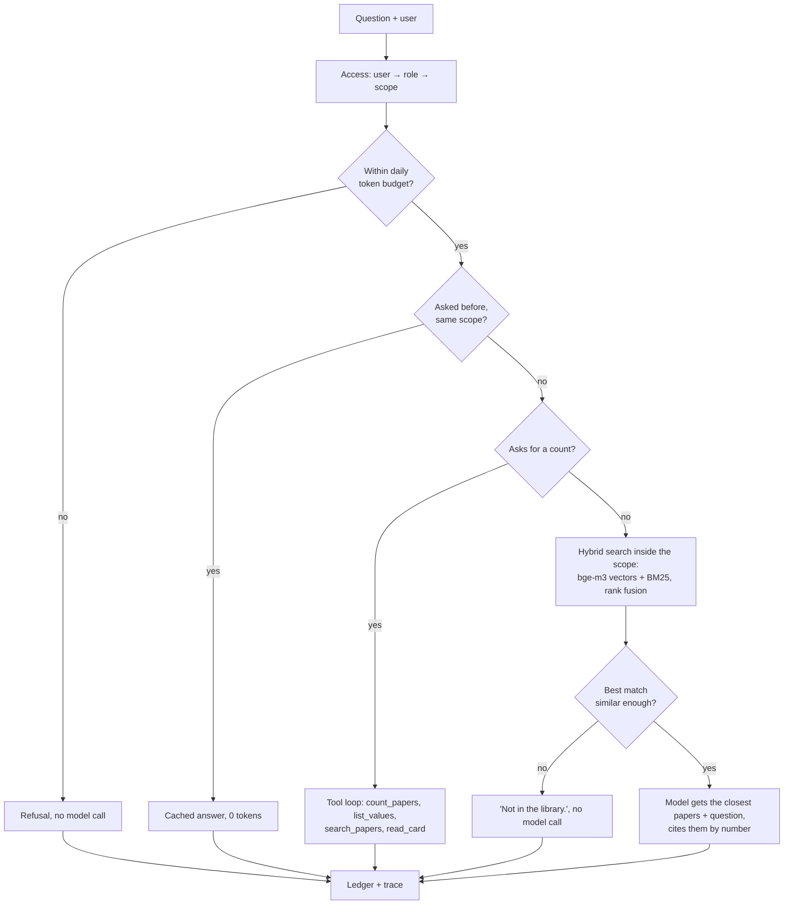

# inhouse-ai

A company-style AI assistant over a research-paper library, built to spend as
few tokens as each answer needs. It answers questions with citations, counts
and lists papers through tools, enforces who may see what, prices and traces
every request, and works with any model API (Claude, DeepSeek, Qwen, Gemini,
GLM, OpenAI, Ollama and other OpenAI-compatible endpoints).

## Results

Evaluated on a private library of **11,476 research-paper cards** (~11.8M
tokens of text, far beyond any context window), with GLM-4.7-Flash (free tier)
as the answering model. 100 questions were written by hand from the library
and scored by code, not by a model. The 39-question test split was run once
with the settings chosen on the 61-question dev split.

| | Test (39) | Dev (61) |
|---|---|---|
| **Correct** | **36 / 39 (92%)** | 54 / 61 (89%) |
| Find a paper from a description | 16 / 16 | 24 / 25 |
| Count papers by year, venue or topic | 7 / 7 | 10 / 10 |
| Questions the library can't answer (must decline) | 6 / 6 | 10 / 10 |
| Questions outside the asker's access (must not leak) | 3 / 3 | 5 / 5 |
| Claims backed by several papers | 4 / 7 | 5 / 11 |
| **Leaks** (an out-of-scope paper named in any answer) | **0** | **0** |
| Tokens per question (input + output) | 1,055 | 1,081 |
| Answered with no model call | 6 / 39 | 11 / 61 |
| Cost per question at Claude Opus 5.5 list prices | ≈ $0.0037 | ≈ $0.0040 |

Sending the cleaned library to the model instead would take ~4.6M input
tokens per question (≈ $18 at the same prices) and fits no context window.
Full numbers, method and failure analysis: [docs/results.md](docs/results.md).

## How it works



- **One client for any model API** (`01_wrapper/`): native Anthropic SDK
  (prompt caching, refusal fallback) or any OpenAI-compatible endpoint, with
  streaming, retries, tool calling and normalised token usage.
- **Local index** (`02_ingest/`): cards are cleaned of placeholder text (61%
  of the library), chunked to ≤ ~400 tokens and embedded on the local GPU with
  bge-m3, into LanceDB with a BM25 index. No API tokens; re-runs only re-embed
  changed cards.
- **Answers with citations** (`03_retrieve/`): hybrid search, only papers
  scoring close to the best match are sent, the model cites `[n]` and the app
  writes the titles.
- **Tools and an MCP server** (`04_tools/`): deterministic count, list, search
  and read tools for the model, and the same tools for any MCP client.
- **Access control** (`05_access/`): roles scope users to groups of papers and
  to tools, enforced as index filters and tool allowlists, never in the prompt.
  Out-of-scope papers are indistinguishable from nonexistent ones.
- **Cost control** (`06_cost/`): prices and a reference cost per answer,
  per-user daily budgets, an exact-repeat answer cache keyed by scope.
- **Tracing** (`07_observe/`): one SQLite row per request (what was retrieved,
  which tools ran, tokens, cost, latency, errors) and a report.

Details and design decisions: [docs/architecture.md](docs/architecture.md),
[docs/decisions/](docs/decisions/).

## Quickstart (demo corpus)

The demo builds a 300-paper corpus from [OpenAlex](https://openalex.org)
(CC0 metadata) in two groups, so search, tools and access control can be tried
without a private library.

```bash
git clone https://github.com/HAINSIS/In-House-AI-Assistant-RAG.git
cd In-House-AI-Assistant-RAG
uv venv --seed --python 3.11 .venv
# PyTorch first (the version the results were produced with); CUDA build:
uv pip install --python .venv torch==2.9.1 --index-url https://download.pytorch.org/whl/cu126
uv pip install --python .venv -r requirements.txt

cp _shared/config/secrets.env.example _shared/config/secrets.env   # add any one API key
.venv/Scripts/python demo/build_demo_corpus.py     # 300 cards into data/demo/
.venv/Scripts/python 02_ingest/ingest.py           # local embeddings (downloads bge-m3 once)

.venv/Scripts/python app/main.py "How many papers in my library were published in 2023?"
.venv/Scripts/python app/main.py --user safety-analyst "Which papers schedule electric vehicle charging?"
.venv/Scripts/python app/main.py                   # chat
```

(On Linux/macOS use `.venv/bin/python`. The first question of a session takes
~20 s while the search model loads.) A free key is enough:
`glm-4.7-flash` on [bigmodel.cn](https://bigmodel.cn) is free; Gemini and
OpenRouter have free tiers. `--provider <name>` picks one, `--list-models`
shows a provider's models. After each answer a status line shows the tokens,
cost and which path answered.

Evaluate the demo, then read the traces:

```bash
.venv/Scripts/python demo/make_demo_questions.py
.venv/Scripts/python evals/run_eval.py --questions data/demo/questions.yaml --split dev
.venv/Scripts/python 07_observe/report.py --last 10
```

## Use your own library

Cards are Markdown files with YAML frontmatter (`title`, `authors`, `year`,
`venue`, `doi`, `subtheme`, optionally `research` for the access group) and an
abstract section; see a demo card in `data/demo/papers/`. Put your deployment's
settings in `_shared/config/settings.local.yaml` (gitignored): each section in
it replaces the same section of `settings.yaml`, typically `corpus` (where the
cards are), `index`, `access` (your users and roles) and `cost` (budgets).

## Use it from Claude Code (MCP)

```bash
claude mcp add --scope user inhouse-ai-library -- <repo>/.venv/Scripts/python.exe <repo>/04_tools/mcp_server.py
```

The server is read-only and runs as one user (`INHOUSE_USER`, default the
`access.default_user`), so a client can't widen its scope.
`python 04_tools/check_mcp.py` checks it end to end.

## Evaluation

`evals/run_eval.py` sends each question through the same pipeline the CLI
uses and scores it with `evals/score.py`: a paper counts as named by its title
or DOI, a count must be the exact number, a decline must name no library
paper, and any answer that names a paper outside the asker's scope fails as a
leak. Runs are resumable, throttled for free tiers, and a second test run of
the same configuration is refused.

## Layout

```
01_wrapper/   model client, provider adapters
02_ingest/    card parsing, chunking, local embeddings, LanceDB index
03_retrieve/  hybrid search, prompt and citations
04_tools/     library tools, MCP server
05_access/    users, roles, scopes
06_cost/      prices, budgets, answer cache
07_observe/   traces and report
app/          CLI and the request pipeline that wires the components
evals/        runner and deterministic scorer
demo/         demo corpus and question builders
_shared/      settings and their loader
docs/         architecture, results, decisions
```

## Limitations

- Claims backed by several papers are the weakest kind (4/7 on test). Part of
  this is the scorer: the library often holds more supporting papers than the
  reference list, so a correct answer citing others fails.
- The source cutoff that saves ~27% of input tokens cost one test question
  that needed two papers but received one. Keeping at least two sources for
  plural questions is the next change to validate.
- Routing between a cheap and a strong model is not implemented: it needs a
  second provider to measure against.
- Measured with one answering model (GLM-4.7-Flash). The Anthropic adapter's
  tool loop has not been run against the live API.

## License

[MIT](LICENSE) © 2026 HADILI ABDELHAMID
